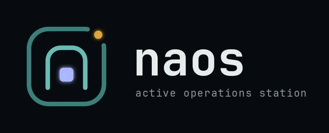
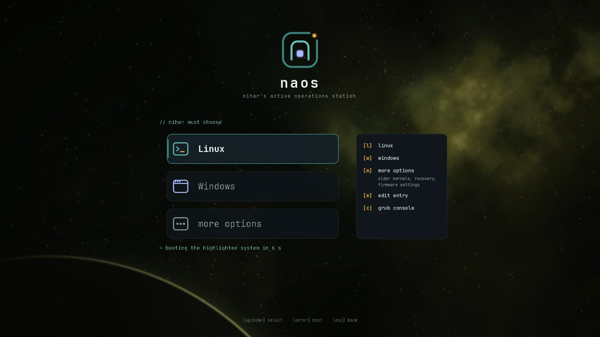
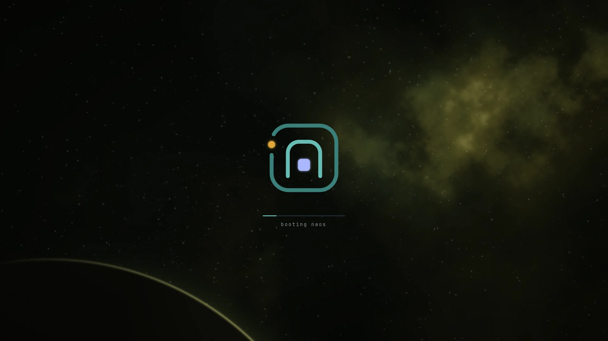
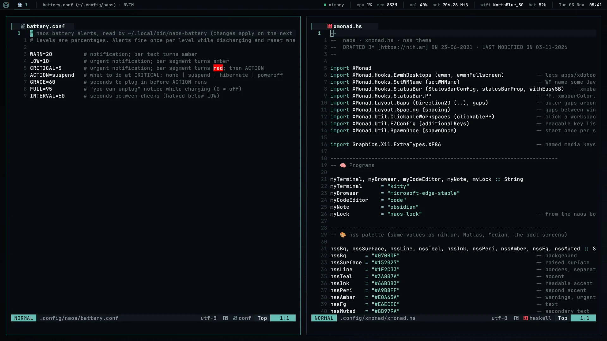
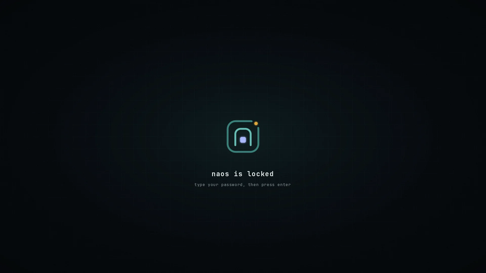

<p align="center"></p>

# Nihar's Dotfiles · naos

Dotfiles for **naos-l**, a Debian 13 laptop running xmonad, in the **nss** palette shared with
[nih.ar](https://nih.ar), Natlas, Arthik and Median. One look from power-on to desktop:

```
firmware logo → GRUB cards → boot animation → lock screen → xmonad
```

Kept as a bare git repo with `$HOME` as the work tree, so files sit where programs expect them and `~` stays clean (XDG).

---

## 📸 Screenshots

| Boot menu | Boot animation |
|---|---|
|  |  |

| Desktop | Lock screen |
|---|---|
|  |  |

Update the desktop shot from the machine itself:
```bash
import -window root -quality 86 ~/.config/readmedoc/naos-desktop.webp    # ImageMagick
```

> This page is edited at `~/.config/readmedoc/README.md`. On every `dot commit` a hook copies it to the
> repo-root `README.md` that GitLab shows (with image paths adjusted). The root copy is not checked out into `~`.

---

## 🎨 nss palette

| | Name | Hex | Used for |
|---|---|---|---|
| ⬛ | bg | `#070B0F` | backgrounds |
| ▪️ | line | `#1F2C33` | borders, separators |
| 🟢 | teal | `#3A807A` | accent, focused border |
| 🩵 | ink | `#66BDB3` | readable accent, keywords |
| 🟣 | periwinkle | `#A9B8FF` | second accent, functions |
| 🟠 | amber | `#E0A63A` | warnings, numbers |
| ⬜ | fg | `#E6ECEC` | text |

Fonts: **JetBrains Mono** (bar, boot screens, lock screen) and **FiraCode Nerd Font** (kitty, for nvim icons).

---

## 📦 Requirements (Debian 13)

```bash
sudo apt install xmonad libghc-xmonad-contrib-dev xmobar kitty neovim picom feh dmenu xdotool \
  zsh zsh-autosuggestions zsh-syntax-highlighting fzf eza bat \
  dunst libnotify-bin i3lock xss-lock x11-utils fonts-noto-color-emoji vnstat \
  pulseaudio-utils network-manager flameshot imagemagick git
```

Arch: install the same tools with pacman/paru (`xmonad-contrib` instead of the libghc package); `.zshrc` loads the zsh plugins from either distro's path.

Also needed: **microsoft-edge-stable** (default browser), **tailscale** (nimory in the bar), and the
**naos boot kit** for GRUB, the boot animation, the lock image and JetBrains Mono.

---

## 🚀 Fresh install

```bash
# 1. clone the bare repo and check out into ~
git clone --bare git@gitlab.com:niharokz/dotfile.git "$HOME/.config/.dotfile"
alias dot='/usr/bin/git --git-dir=$HOME/.config/.dotfile --work-tree=$HOME'
dot checkout                     # move any clashing default files away first
dot config status.showUntrackedFiles no
dot config core.hooksPath "$HOME/.config/naos/setup/dot-hooks"           # keeps the root README in sync
dot sparse-checkout set --no-cone '/*' '!/README.md' '!/.gitignore'      # repo-root files stay out of ~

# 2. system settings: zsh in ~/.config/zsh, no sudo/hushlogin files in ~, Edge as browser, packages
sudo bash ~/.config/naos/setup/system-setup.sh

# 3. move anything left in ~ to its XDG place (shows a plan; --apply to do it)
bash ~/.config/naos/setup/migrate-home.sh
bash ~/.config/naos/setup/migrate-home.sh --apply

# 4. boot kit (GRUB cards, boot animation, lock screen, fonts)
sudo bash naos-boot-kit/install.sh

# 5. reboot; tty1 logs in and starts X
```

After the first login: open `nvim` and run `:Lazy sync`. Rename the machine with
`sudo hostnamectl set-hostname naos-l` (Windows side: `naos-w`).

---

## 🗂 What lives where

| Path | What |
|---|---|
| `.config/zsh/` | `.zprofile` (environment, starts X on tty1), `.zshrc` (prompt, history, completion, vim keys, plugins), `aliases.zsh` |
| `.config/X11/xinitrc` | monitors, lock on lid close / suspend, syncthing, `exec xmonad` |
| `.config/xmonad/xmonad.hs` | layout, keys, workspaces, starts picom, dunst and the battery watcher |
| `.config/xmobar/xmobarrc` | top bar; helper scripts in `.local/bin` |
| `.config/kitty/kitty.conf` | terminal colours and font |
| `.config/nvim/init.lua` | lazy.nvim, catppuccin engine with nss colours; pins older plugins on nvim 0.10 |
| `.config/picom/picom.conf` | rounded corners, shadows, blur |
| `.config/dunst/dunstrc` | notifications |
| `.config/naos/battery.conf` | battery alert levels and the action at critical |
| `.config/naos/nimory.conf` | bar dot: host, ssh command, dashboard URL |
| `.config/naos/setup/` | `system-setup.sh` (sudo, once), `migrate-home.sh` (XDG moves), `cleanup.sh` (retire old configs) |
| `.config/mimeapps.list` | Edge for web links |
| `.config/user-dirs.dirs` | downloads, music, photos, videos on `/data`; no Desktop/Documents folders in `~` |
| `.local/bin/` | `naos-battery`, `naos-volume`, `naos-wifi`, `naos-net`, `nimory-status` |
| `.local/share/naos/icons/` | bar logo |
| `.config/readmedoc/` | this page (`README.md`) and its screenshots; copied to the repo root on commit |
| `.config/naos/setup/dot-hooks/` | the git hook that does that copy |

`niharfetch.sh` (system info with the naos logo) lives in `$WORK/narch`.

---

## ⌨️ Keys

| Key | Action |
|---|---|
| `Super+Enter` | kitty |
| `Super+d` | dmenu (or click the logo in the bar) |
| `Super+z` | Edge · `Super+b` Brave incognito |
| `Super+c` | VS Code · `Super+o` Obsidian · `Super+e` edit configs |
| `Super+x` | close window |
| `Super+Esc` | lock screen |
| `Super+Shift+s` | screenshot (flameshot) |
| `Super+Shift+b` | show / hide the bar |
| `Super+Ctrl+x` | power menu |
| `Super+s` | Surfshark VPN |
| `Super+1…9` | workspaces (or click them in the bar) |
| `Super+q` | reload xmonad |

Bar: click the logo for dmenu, the volume to mute (scroll to change), Wi-Fi for `nmtui`,
the nimory dot to `ssh nimory` (right click: dashboard).

---

## 🔋 Battery alerts

Set in `.config/naos/battery.conf`: notice at 20%, urgent alert and amber bar at 10%,
red bar and a 60 s countdown to `suspend` at 5% (cancelled by plugging in), "unplug" notice at 95%.
Check with `naos-battery --status`.

---

## 🧹 Clean home (XDG)

`~` holds only what programs hardcode: `.ssh`, `.pki`, `.vscode`, `.ollama`, `.copilot`, plus `.cache`, `.config` and `.local`. `/etc/zsh/zshenv` points zsh at `~/.config/zsh`, the X auth file lives in `$XDG_RUNTIME_DIR`,
and every tool that can be told (go, cargo, npm, docker, gnupg, python, less, ...) is set in `.zprofile`.

---

## 📚 References

- [Bare git repo for dotfiles](https://developer.atlassian.com/blog/2016/02/best-way-to-store-dotfiles-git-bare-repo/)
- [XDG Base Directory](https://wiki.archlinux.org/title/XDG_Base_Directory)
